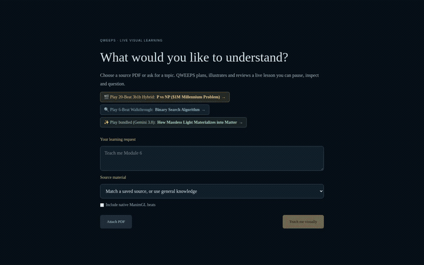
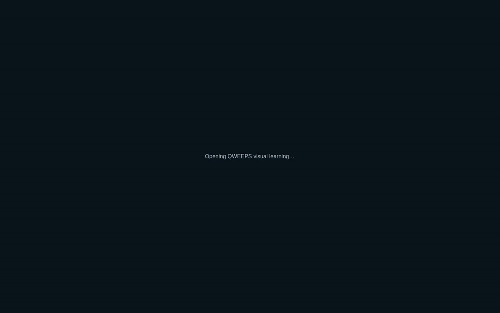
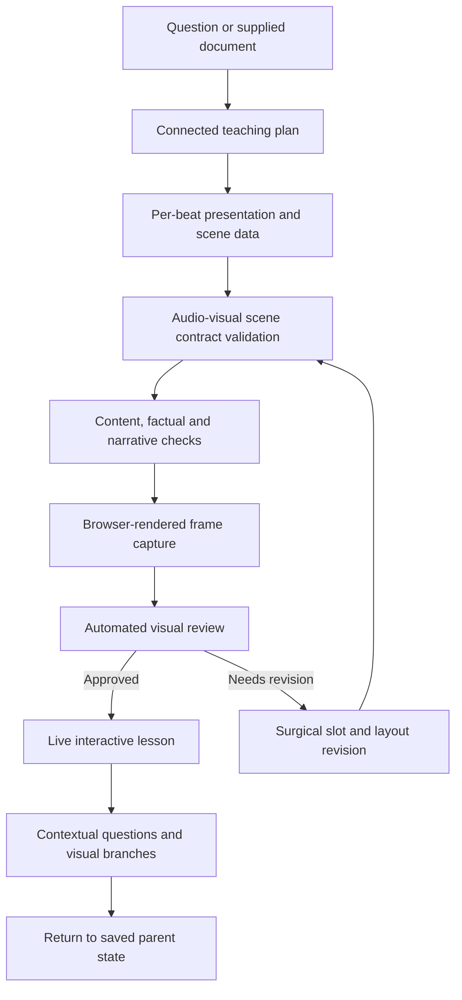

# QWEEPS — Live Interactive Visual Teaching

[](https://doi.org/10.5281/zenodo.23791785)
[](https://orcid.org/0009-0003-2325-7968)
[](LICENSE)
[](LICENSE-DOCUMENTATION)

AI-generated visual lessons with synchronized narration, interactive exploration, and contextual Q&A.

QWEEPS is an experimental local teaching system that turns a question or supplied document into a live visual explanation. It plans connected reasoning beats, chooses a presentation method for each beat, generates scene data, and checks content and actual browser-rendered frames before making a lesson available.

Learners can pause, move through the explanation, inspect objects or a selected region, ask questions, and request a focused visual branch. The browser scenes use SVG, GSAP and a Hyperframes adapter. **Live playback does not require baking an MP4.** Native Manim export and rendering are separate, optional paths.

## Demos

### 1. Full Live Browser Lesson: P vs NP
Real-time browser playback of the complete **P vs NP: The $1,000,000 Question of Computer Science** lesson — all 20 beats, opened from the QWEEPS website and played through without skipping. The run combines native ManimGL mathematical animation with SVG/GSAP explanatory layouts, synchronized speech narration, and the full player chrome: chapter timeline, captions, seek controls, and lesson context.



> [!NOTE]
> High-definition video with speech audio is available at [`demos/demo1-p-vs-np-lesson.mp4`](demos/demo1-p-vs-np-lesson.mp4). The inline GIF is the complete lesson at 8× speed; no beats are omitted.

### 2. "Ask Qweeps" Contextual Branch Mini-Lesson
Interactive Q&A exploration on Beat 7 of the *P vs NP* lesson. Selecting **Branch mini-lesson** generates and streams a dedicated 3-beat visual explanation rendered with ManimGL, plays the whole branch, then returns through the persistent breadcrumb to the saved parent lesson position.


> [!NOTE]
> High-definition video with speech audio is available at [`demos/demo2-ask-qweeps-full-branch.mp4`](demos/demo2-ask-qweeps-full-branch.mp4).

### 3. Reinforcement Quiz: P vs NP
The P vs NP lesson ships with a 20-card mastery quiz. The demo opens it from the website's generated-lesson list and answers core-inference and visual-mechanism cards with immediate explanations, live streak and mastery progress. One concept is deliberately missed to trigger **3-card spaced recall**, then cleared on its retry to show the reinforcement loop that repeats missed cards until mastery.



> [!NOTE]
> High-definition video with synthesized feedback audio is available at [`demos/demo3-quiz-p-vs-np.mp4`](demos/demo3-quiz-p-vs-np.mp4).

## Project status

This is a research and development prototype. Automated review can miss factual, visual and teaching errors; it is not independent expert review or evidence of improved learning outcomes. External providers can time out or become unavailable.

The archive includes three fully bundled, offline-playable interactive lessons with narration audio:
1. **P vs NP: The $1,000,000 Question of Computer Science** (`b1b20bea700000000000000000000001`): A full 20-beat hybrid lesson combining native ManimGL mathematical animations with SVG/GSAP explanatory layouts, complete with master continuous narration and per-beat audio fallbacks.
2. **Binary Search Algorithm** (`1ac198aec0efc9ba04dfa14bd242bd33`): An interactive 6-beat algorithm walkthrough featuring Lucide vector icons, dynamic interval halving, and cue-synchronized speech.
3. **How Massless Light Materializes into Matter** (`61d56323819e14949204a5e95f1214fc`): A 4-beat interactive lesson with full narration audio and complete rendered-frame review verification receipts.

These are reproducible demonstration artifacts, not a guarantee that every new request will produce an equally good lesson.

## Try the bundled lessons

### Requirements

- Python 3.11 or newer and a browser. The primary development environment is Linux/Omarchy; other platforms have not been established as supported.
- The supplied `visual-studio/dist/` and `bundled-lessons/` directories, retained alongside the source checkout. A Python package installation alone does not bundle the whole studio.
- For **new lesson generation and contextual Q&A**: an OpenRouter API key (supports 100% free models like `nvidia/nemotron-3.5-super-vl:free`), OpenCode Go credentials, or a local CLI runner.
- For **new Fish narration**: an OpenRouter API key and the configured Fish model/voice, plus the local speech-alignment runtime described in [visual learning documentation](docs/visual-learning.md). Playing the included recording does not require generating it again.

### Install from the source checkout

```bash
git clone https://github.com/acceptance27/qweeps.git
cd qweeps
python3 -m venv .venv
source .venv/bin/activate
python -m pip install -e .
```

If using the Zenodo ZIP, extract it and run the same environment/install commands from its root instead of cloning. Keep the checkout in place when using the editable installation.

### Optional native Manim and CE export

The bundled lesson and normal browser lessons do not require these. They are
needed only for native ManimGL chapters, CE text metrics, or MP4 export.

- **ManimGL runtime:** a separate Python environment containing `manimlib` and
  a working OpenGL context, at `~/.local/share/qweeps/visual-venv` or
  `~/.local/share/omarchy-assistant/visual-venv`. Override with
  `QWEEPS_MANIMGL_PYTHON`. Required to compile or play native chapters.
- **ManimCE runtime:** an optional environment containing `manim`, at
  `~/.local/share/qweeps/manim-ce` or
  `~/.local/share/omarchy-assistant/manim-ce`. Override with
  `QWEEPS_MANIM_PYTHON` (or `QWEEPS_MANIM_CE_PYTHON`). Used for CE text metrics
  and local CE renders; missing metrics fall back to native Pango metrics.
- **ffmpeg:** required for new narration synchronization and frame review.
- **LaTeX (`latex`, `dvisvgm`):** required only for `MathTex`/`Tex` and
  `DecimalNumber` scenes. The 8080 CE environment may not include it.
- **Generative Manim service:** optional, only for CE/GL MP4 export through
  `http://127.0.0.1:8080` (`QWEEPS_GM_URL`, `QWEEPS_GM_API_KEY`,
  `QWEEPS_GM_RENDERER`). Not required for live native playback.

Run `qweeps doctor` to see which runtimes are present. The detailed setup and
troubleshooting notes are in [visual learning](docs/visual-learning.md) and
[native ManimGL runtime](docs/native-manimgl-runtime.md).

With the default generation provider installed and configured, start the studio:

```bash
python -m assistant.visual.server
```

Open [the studio](http://127.0.0.1:4174), or launch any of the bundled lessons:
- [P vs NP: The $1,000,000 Question (20 beats hybrid)](http://127.0.0.1:4174/?lesson=b1b20bea700000000000000000000001)
- [Binary Search Algorithm (6 beats walkthrough)](http://127.0.0.1:4174/?lesson=1ac198aec0efc9ba04dfa14bd242bd33)
- [How Massless Light Materializes into Matter (4 beats)](http://127.0.0.1:4174/?lesson=61d56323819e14949204a5e95f1214fc)

The supplied build requires no npm command for playback. Provider construction happens at server startup, so the default configuration still requires `agy` even when opening a saved lesson.

**Replay without provider access:** in `~/.config/qweeps/config.toml` (or local `.env`), set `enabled = false` under `[llm]` and `provider = "none"` under `[tts]` before starting the server. Retain the other settings for later use. This disables new AI generation, AI answers and speech synthesis; the bundled lessons and their saved audio remain available. Re-enable the relevant providers for live questions or new lessons.

### Controls

- **Space:** toggle play / pause.
- **Left / Right:** move to the previous or next beat at its completed state.
- **Shift + Left / Right:** move to the start of the previous or next beat.
- **Scrubber:** seek smoothly across the measured audio-visual timeline.
- **Inspect & Region:** click any labeled visual element or drag a rectangle to focus question context.
- **Ask Qweeps:**
  - **Text reply:** provides instant contextual answers and speech without altering or interrupting the scene.
  - **Branch mini-lesson:** generates a focused multi-beat visual sub-lesson (using native ManimGL or layout) diving into the queried concept, with breadcrumb navigation returning seamlessly to the saved parent timestamp, camera, and selection.

See [setup, controls, architecture and limitations](docs/visual-learning.md) for details.

## How the teaching pipeline works



- **Choose methods per beat:** geometric construction, descriptive infographic, worked execution, comparison or another approach appropriate to the inference. A lesson need not repeat one layout throughout.
- **Audio-visual scene contract (`scene_contract.py`):** strictly enforces that narration explicitly names and describes visible elements created on that beat, eliminating disconnected or "blind" voiceovers.
- **Speech-to-geometry cue alignment:** maps narration phrases to measured word timing so visual reveals, arrows, and attention outlines trigger at the exact instant they are spoken.
- **Dynamic Lucide animated vector icons:** automatically provides clean, animated SVG iconography with instant Lucide fallback, ensuring no missing or question-mark placeholders.
- **Keep reasoning connected:** preserve object identities and explain why the next question follows from the previous result via spoken bridges.
- **Elastic duration and pacing:** stretches beat windows up to 1.20x max stretch cap to fit spoken narration, or triggers surgical slot condensing if narration exceeds budget.
- **Validate scene data:** reject unsupported fields, AABB collisions, or incomplete outputs rather than inventing missing geometry.
- **Inspect actual frames:** review early and completed states, plus intermediate states for diagrams. Failed candidates remain unapproved after the bounded revision allowance is exhausted.
- **Preserve exploration context:** include the parent scene, time, selection, camera and experiment state when branching.

The maintained teaching skill draws on PDF Explainer, Math 01, A* Pathfinding & Heuristics and the accepted Rizal reference. These are authoring references, not evidence of equivalence to their visual quality or to 3Blue1Brown's work.

## Current limitations and proposed work

- Generated explanations can contain incorrect facts, unclear mechanisms, overlaps or poor visual choices despite passing automated checks. General-topic model review is not the same as verification against retrieved sources.
- Generated choice interactions highlight cases and explain consequences; they are not a general numerical simulation engine. The authored A* demonstration has its own executable grid-search behavior.
- Provider response times vary. There is no guaranteed sub-second response or first-pass lesson approval. Interrupted preparation can resume saved checkpoints where available.
- Default lesson requests have a bounded network timeout. A timeout alone does not identify whether the cause was reasoning, response length, transport failure or provider delay.
- **Proposed, not implemented as a general system:** perimeter-port routing for diagrams, relative annotation constraints, failed-frame images supplied directly to the reviser, and selective bounding-box collision telemetry. Existing text-fit checks are more limited.
- No controlled model ranking, learning-outcome study or fixed recall improvement is claimed.

Read the [technical report](docs/QWEEPS_Live_Visual_Teaching_Technical_Report.pdf) for the implementation audit, proposed layout/revision design and evaluation plan.

## Models, narration and configuration

Configuration is stored at `~/.config/qweeps/config.toml` (or via environment variables and local `.env`). Roles are configurable; the inspected defaults separate ordinary chat from lesson work:

| Role | Default route |
|---|---|
| General conversation and orchestration text | OpenRouter: `nvidia/nemotron-3.5-super-vl:free` |
| Lesson planning, direction, review, narration writing and lesson Q&A | OpenRouter Free: `nvidia/nemotron-3.5-super-vl:free` (or OpenCode Go) |
| Speech synthesis | Configurable independently; default is Fish via OpenRouter, with Piper and eSpeak as options |
| Speech recognition | OpenRouter Cloud STT (`fish-audio/transcribe-1`) by default; Voxtype local as an option |

These are configured route identifiers, not guarantees of current provider availability or price. Lesson narration writing and voice synthesis are different stages: changing the lesson model does not change the selected voice.

```toml
[llm]
enabled = true
base_url = "https://openrouter.ai/api/v1"
auth_provider = "openrouter"
api_key_env = "OPENROUTER_API_KEY"
model = "nvidia/nemotron-3.5-super-vl:free"
fallback_models = []
fallback_provider = "offline"
visual_provider = "openrouter-free"
visual_model = "nvidia/nemotron-3.5-super-vl:free"
visual_vision_model = "nvidia/nemotron-3.5-super-vl:free"
reasoning_effort = "none"

# Fish synthesis
[tts]
provider = "openrouter"
base_url = "https://openrouter.ai/api/v1"
model = "fish-audio/s2.1-pro-free:free"
voice = "33a2191b8fda440cae962137e9793985"
```

Use `qweeps set-key` for the OpenRouter key, or configure a local `.env` file (`OPENROUTER_API_KEY=...`). See the visual documentation for alternative provider adapters and alignment requirements.

## CLI commands

| Command | Purpose |
|---|---|
| `qweeps visual [topic]` | Open the visual interface or generate a new topic |
| `qweeps visual serve` | Start the local visual studio server |
| `qweeps visual mcp` | Start the Model Context Protocol (MCP) tool server |
| `qweeps doctor` | Inspect configured dependencies and providers |
| `qweeps set-key` | Configure the OpenRouter API key |
| `qweeps --help` | List available CLI commands and options |

## Development and checks

Backend checks, from the repository root:

```bash
python -m pip install -e ".[dev]"
python -m pytest tests/
```

Frontend development requires Node.js/npm and the studio's dependencies:

```bash
cd visual-studio
npm ci
npm test
npm run lint
npm run build
```

Automated tests exercise software behavior, including routing, validation, cue timing, navigation and saved branch state. Fixture or mocked-provider tests do not establish successful fresh model generation or teaching effectiveness.

## Citation and attribution

Author: **Rayven Pahignalo** · [ORCID 0009-0003-2325-7968](https://orcid.org/0009-0003-2325-7968)

```bibtex
@software{pahignalo_qweeps_2026,
  author       = {Pahignalo, Rayven},
  title        = {QWEEPS: Live Interactive Visual Teaching},
  year         = 2026,
  publisher    = {Zenodo},
  doi          = {10.5281/zenodo.23791785},
  url          = {https://doi.org/10.5281/zenodo.23791785}
}
```

## Licensing

- **Application code:** [PolyForm Noncommercial License 1.0.0](LICENSE).
- **Technical report and QWEEPS-authored documentation/lesson content:** [CC BY-NC 4.0](LICENSE-DOCUMENTATION), subject to the exclusions in [LICENSING.md](LICENSING.md).
- **Third-party notices:** [THIRD_PARTY_NOTICES.md](THIRD_PARTY_NOTICES.md), with full license texts in [LICENSES/](LICENSES/).
- **Visual asset provenance:** [visual-studio/public/live/assets/SOURCES.md](visual-studio/public/live/assets/SOURCES.md).

This release is source-available with noncommercial restrictions. PolyForm defines
its permitted purposes, including specified organizational uses; commercial uses
outside those permissions require separate authorization. See the full license
rather than assuming every research or educational activity is covered.

Earlier MIT grants are not revoked by this change. See [licensing scope and prior
releases](LICENSING.md) for details. For reproducible references, identify the
release or commit and the deposited archive version.

An unrelated teaching PDF with unverified redistribution permission is excluded
from this release. See the [redistribution review](docs/redistribution-review.md).
