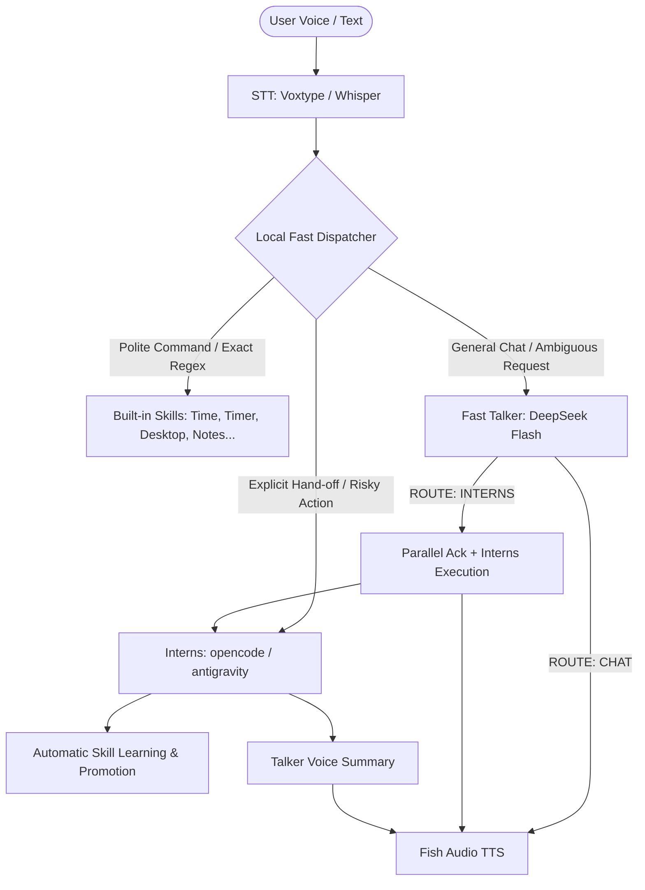

# QWEEPS — Live Interactive Visual Teaching

> AI-generated visual lessons with synchronized narration, interactive exploration, and contextual Q&A.

---

## What is QWEEPS?

QWEEPS is a local, voice-first companion and system coordinator for Omarchy Linux workstations with an autonomous visual teaching engine. It pairs AI-generated visual lessons, interactive step-by-step simulations, and synchronized narration with built-in desktop skills and coding agents.

QWEEPS operates under a **Talker-Reasoner** architecture:
- **The Talker (Quick-Response Voice Layer)**: Uses a fast non-thinking model (DeepSeek V4.1 Flash via OpenRouter/OpenCode Zen) framed as the voice interface of the local daemon. It answers questions, chats, and coordinates hand-offs with sub-second latency.
- **The Reasoner / Hands ("My Interns")**: When a task requires local filesystem manipulation, code execution, system monitoring, or complex desktop operations, QWEEPS delegates the task to background coding agents (such as `opencode` or `antigravity`).
- **The Voice Stack**: Speech-to-text (STT) powered by Voxtype (Whisper / Cohere / Parakeet) paired with natural text-to-speech (TTS) powered by Fish Audio (`s2.1-pro-free` via OpenRouter), local Piper, or eSpeak.

---

## Architecture & Request Flow



### Key Architectural Behaviors
1. **Classification-First Protocol (`ROUTE / TASK / SAY`)**: The Talker is forced to decide `ROUTE: CHAT` vs `ROUTE: INTERNS` before outputting conversational text, eliminating LLM capability refusals.
2. **Parallel Acknowledgment**: When an action is sent to the Interns, QWEEPS confirms immediately out loud (*"On it! My Interns are closing the browser and checking CPU usage now..."*) while the Interns begin work simultaneously in the background.
3. **Unified Speech Delivery**: Full sentences are sent to Fish Audio at once for seamless, natural voice prosody without mid-sentence chops.
4. **Autonomous Skill Promotion**: Headless agent tasks that reduce to single commands are saved as persistent skills, turning one-off terminal actions into instant local tools.

---

## What QWEEPS Can Do

### 1. Instant Built-in Skills (Sub-100ms)
- **Time & Stopwatch**: Check the current time, start/stop/query stopwatches.
- **Timers & Reminders**: Set countdown timers or schedule reminders (`"remind me to check the oven in 15 minutes"`).
- **Desktop & Hyprland Control**:
  - Focus, move, or close workspace tiles (`"move this window to workspace 3"`).
  - Toggle fullscreen, floating, top bar, scratchpad, or night light.
  - Adjust system volume (`"set volume to 80"`, `"mute"`).
  - Open new browser windows or search sites (`"search github for fastchat"`).
- **Window Queries**: Inspect what apps and coding agents are currently open.
- **App Launcher**: Launch applications by name (`"open firefox"`, `"launch terminal"`).
- **Configured Routes**: Deep links and shortcut launchers (e.g. Teams, Web links).
- **System Status**: Check whether STT, TTS, LLM, or agent backends are operational.

### 2. Interactive Visual Learning
- **Live AI conversation**: Ask the configured QWEEPS model about the current time, selected objects or region, and attached source excerpts.
- **Actual A* grid trace**: Inspect the open queue, accumulated costs, walls, parent links and shortest path. Drag S/G to recompute.
- **Reference-guided teaching harness**: Plan visual inferences, direct the animation, and review the explanation against PDF Explainer, Math 01, and A* Pathfinding & Heuristics.
- **Saved branches**: Open a visual answer and return to the parent's saved time, camera, selection and experiment.
- **Manim export/rendering**: Compile generated plans into Manim Community Edition scenes and preview MP4 output.
- **Shared controls**: Voice, browser and optional MCP tools use the same local session.
- **Autonomous Multi-Stage Visual Generation**: Autonomously plans, scripts, generates SVG vector diagrams, conducts automated physics & narrative consistency checks, captures real browser screenshots, and executes multimodal vision reviews using Gemini 3.8 Flash Vision.
- **Bundled Lesson Included**: Includes the published, fully-reviewed interactive lesson *"How Massless Light Materializes into Matter"* (`bundled-lessons/`) complete with synchronized narration audio.

#### Quick Start (Visual Learning & Bundled Lesson)
```bash
# Start the local visual studio server (uses pre-built bundle, no npm required)
python -m assistant.visual.server

# Open http://127.0.0.1:4174 in your browser
# Or play the bundled lesson directly:
# http://127.0.0.1:4174/?lesson=61d56323819e14949204a5e95f1214fc
```

See [visual learning setup, controls, architecture and limitations](docs/visual-learning.md).

### 3. Personal Knowledge & Productivity
- **Notes**: Create, read, and search local Markdown notes in your vault (`~/Documents/Vault` or `~/Documents/Notes`).
- **Documents & Deep Research**: Draft long-form Markdown documents or conduct multi-step web research reports.
- **Long-Term Memory**: Remember user preferences and personal facts (`"remember that I prefer dark mode"`).
- **Semantic RAG**: Instant local semantic search over notes and documentation using SQLite embeddings.
- **Google Calendar & Drive Integration**: OAuth-backed calendar event queries, event scheduling, and Google Docs synchronization.

### 4. "The Interns" (Autonomous System Execution)
Anything outside built-in skills is seamlessly dispatched to coding agents (`opencode` or `antigravity`):
- Run shell commands and diagnostics (`"check disk space on all mounted drives"`).
- Kill processes or unbind ports (`"kill whatever is listening on port 8080"`).
- Read, modify, compile, or debug code in your workspaces.
- Check hardware metrics (CPU, GPU load, temperatures, battery).
- Install packages and configure Arch Linux software.
- In-character progress reporting and spoken summaries of complex output.

---

## Installation & Setup

### Requirements
- Linux (Arch Linux / Omarchy recommended)
- Python >= 3.11
- Hyprland (for desktop window management features)
- `mpv` or `ffplay` (for audio playback)
- OpenRouter API key (for Fish Audio TTS & DeepSeek Flash LLM) or local Piper/eSpeak

### Quick Install
```bash
cd omarchy-assistant
./packaging/install.sh
```

### Hyprland Keybinding
Add the summon hotkey to your `~/.config/hypr/bindings.lua` (or `hyprland.conf`):
```lua
o.bind("SUPER + SHIFT + A", "Ask QWEEPS", "omarchy-assistant summon")
```

---

## CLI Reference

`omarchy-assistant` includes a rich command-line interface:

| Command | Description |
|---|---|
| `omarchy-assistant text "..."` | Handle a single text input turn and speak the result |
| `omarchy-assistant chat` | Interactive conversational terminal REPL |
| `omarchy-assistant listen` | Listen from microphone, transcribe with STT, and respond |
| `omarchy-assistant summon` | Pop up an interactive desktop input prompt |
| `omarchy-assistant ask "..."` | Stream newline-delimited tokens for desktop GUI overlays |
| `omarchy-assistant doctor` | Diagnostic report of LLM, TTS, STT, and Intern dependencies |
| `omarchy-assistant skills [list/remove]` | View or manage registered built-in and promoted skills |
| `omarchy-assistant capabilities [list]` | View available vs. planned capabilities |
| `omarchy-assistant interns [list/clear]` | Inspect running and historical agent tasks |
| `omarchy-assistant facts [list/add/forget]` | Manage remembered user facts |
| `omarchy-assistant sessions [list/show/clear]` | Inspect or wipe conversation history |
| `omarchy-assistant set-key` | Configure and persist your OpenRouter API key |
| `omarchy-assistant set-calendar` | Run Google OAuth setup for Calendar & Drive sync |
| `omarchy-assistant visual [topic]` | Launch or control interactive 3Blue1Brown visual explainers (e.g. `astar`) |
| `omarchy-assistant api` | Run OpenAI-compatible HTTP server (`127.0.0.1:8765`) for Home Assistant |
| `omarchy-assistant serve` | Start the background timer and reminder notification daemon |
| `omarchy-assistant logs` | View recent assistant runtime logs |

---

## Configuration (`config.toml`)

The configuration file is located at `~/.config/omarchy-assistant/config.toml`.

```toml
[llm]
enabled = true
base_url = "https://openrouter.ai/api/v1"
auth_provider = "openrouter"
api_key_env = "OPENROUTER_API_KEY"
model = "nvidia/nemotron-3.5-super-vl:free"
fallback_models = []
fallback_provider = "offline"             # antigravity | offline
visual_provider = "antigravity"
visual_model = "gemini-3.8-flash-high"
visual_vision_model = "gemini-3.8-flash-high"
classify_mode = "local"
reasoning_effort = "none"

[tts]
provider = "openrouter"              # openrouter | piper | espeak | none
base_url = "https://openrouter.ai/api/v1"
model = "fish-audio/s2.1-pro-free:free"
voice = "33a2191b8fda440cae962137e9793985"
stream = true                        # stream mp3 bytes directly into player
split_sentences = false              # false delivers natural full-sentence prosody

[stt]
provider = "voxtype"                 # voxtype | openrouter | file | none
engine = "whisper"                   # whisper | cohere | parakeet

[agent]
enabled = true
command = ["opencode", "run", "--auto", "{prompt}"]
fallback_command = ["agy", "--continue", "--print", "{prompt}"]
visible_only = true                  # interact with open desktop agent windows
promote_skills = true                # learn repeatable commands as persistent skills
report = true                        # speak conversational summaries of long agent output

[persona]
enabled = true
name = "QWEEPS"
register = "gush"                    # gush | report
hands = "a small crew of coding agents who are your hands"
```

---

## Running Tests

Run the test suite using `pytest`:
```bash
uv run --with pytest pytest tests/
```
Tests cover routing, voice, visual model validation, scene context, session isolation, and the local API.
