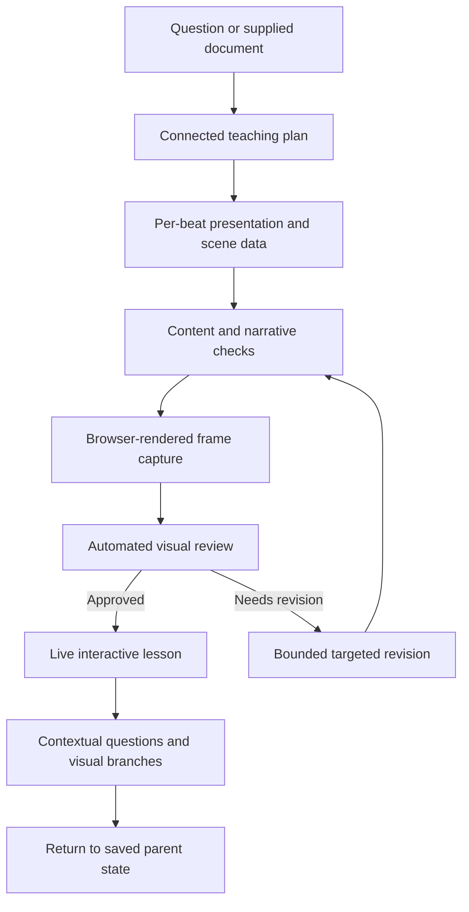

# QWEEPS — Live Interactive Visual Teaching

[](https://doi.org/10.5281/zenodo.23791785)
[](https://orcid.org/0009-0003-2325-7968)
[](LICENSE)
[](LICENSE-DOCUMENTATION)

AI-generated visual lessons with synchronized narration, interactive exploration, and contextual Q&A.

QWEEPS is an experimental local teaching system that turns a question or supplied document into a live visual explanation. It plans connected reasoning beats, chooses a presentation method for each beat, generates scene data, and checks content and actual browser-rendered frames before making a lesson available.

Learners can pause, move through the explanation, inspect objects or a selected region, ask questions, and request a focused visual branch. The browser scenes use SVG, GSAP and a Hyperframes adapter. **Live playback does not require baking an MP4.** Native Manim export and rendering are separate, optional paths.

The project also includes the Omarchy desktop assistant from which it developed. Its existing CLI and configuration directory retain the `omarchy-assistant` name.

## Project status

This is a research and development prototype. Automated review can miss factual, visual and teaching errors; it is not independent expert review or evidence of improved learning outcomes. External providers can time out or become unavailable.

The archive includes **How Massless Light Materializes into Matter**, a saved interactive lesson with narration audio. Its saved review records approval by QWEEPS's automated content and rendered-frame checks. This is a reproducible demonstration artifact, not a guarantee that every new request will produce an equally good lesson.

## Try the bundled lesson

### Requirements

- Python 3.11 or newer and a browser. The primary development environment is Linux/Omarchy; other platforms have not been established as supported.
- The supplied `visual-studio/dist/` and `bundled-lessons/` directories, retained alongside the source checkout. A Python package installation alone does not bundle the whole studio.
- For **new lesson generation and contextual Q&A** with the default configuration: an installed, authenticated Antigravity CLI (`agy`) with access to the configured models.
- For **new Fish narration**: an OpenRouter API key and the configured Fish model/voice, plus the local speech-alignment runtime described in [visual learning documentation](docs/visual-learning.md). Playing the included recording does not require generating it again.

### Install from the source checkout

```bash
git clone https://github.com/acceptance27/qweeps.git
cd qweeps
python3 -m venv .venv
source .venv/bin/activate
python -m pip install -e .
```

If using the Zenodo ZIP, extract it and run the same environment/install commands from its root instead of cloning. Keep the checkout in place when using the editable installation.

With the default generation provider installed and configured, start the studio:

```bash
python -m assistant.visual.server
```

Open [the studio](http://127.0.0.1:4174), or [the bundled lesson](http://127.0.0.1:4174/?lesson=61d56323819e14949204a5e95f1214fc).

The supplied build requires no npm command for playback. Provider construction happens at server startup, so the default configuration still requires `agy` even when opening a saved lesson.

**Replay without provider access:** in `~/.config/omarchy-assistant/config.toml`, set `enabled = false` under `[llm]` and `provider = "none"` under `[tts]` before starting the server. Retain the other settings for later use. This disables new AI generation, AI answers and speech synthesis; the bundled lesson and its saved audio remain available. Re-enable the relevant providers for live questions or new lessons.

### Controls

- **Left / Right:** move to the previous or next beat at its completed state.
- **Shift + Left / Right:** move to the start of the previous or next beat.
- Pause or seek to revisit a construction; select objects or a region to provide question context.
- **Ask & Explore:** ask about the current scene or request a visual branch, then return to the saved parent state.

See [setup, controls, architecture and limitations](docs/visual-learning.md) for details.

## How the teaching pipeline works



- **Choose methods per beat:** geometric construction, descriptive infographic, worked execution, comparison or another approach appropriate to the inference. A lesson need not repeat one layout throughout.
- **Keep reasoning connected:** preserve object identities and explain why the next question follows from the previous result.
- **Validate scene data:** reject unsupported fields or incomplete outputs rather than inventing missing geometry.
- **Inspect actual frames:** review early and completed states, plus intermediate states for diagrams. Failed candidates remain unapproved after the bounded revision allowance is exhausted.
- **Synchronize to generated speech:** map exact narration phrases to measured word timing, rather than asking the model to guess audio timestamps.
- **Preserve exploration context:** include the parent scene, time, selection, camera and experiment state when branching.

The maintained teaching skill draws on PDF Explainer, Math 01, A* Pathfinding & Heuristics and the accepted Rizal reference. These are authoring references, not evidence of equivalence to their visual quality or to 3Blue1Brown's work.

## Current limitations and proposed work

- Generated explanations can contain incorrect facts, unclear mechanisms, overlaps or poor visual choices despite passing automated checks. General-topic model review is not the same as verification against retrieved sources.
- Generated choice interactions highlight cases and explain consequences; they are not a general numerical simulation engine. The authored A* demonstration has its own executable grid-search behavior.
- Provider response times vary. There is no guaranteed sub-second response or first-pass lesson approval. Interrupted preparation can resume saved checkpoints where available.
- Default lesson requests have a bounded Antigravity timeout. A timeout alone does not identify whether the cause was reasoning, response length, transport failure or provider delay.
- **Proposed, not implemented as a general system:** perimeter-port routing for diagrams, relative annotation constraints, failed-frame images supplied directly to the reviser, and selective bounding-box collision telemetry. Existing text-fit checks are more limited.
- No controlled model ranking, learning-outcome study or fixed recall improvement is claimed.

Read the [technical report](docs/QWEEPS_Live_Visual_Teaching_Technical_Report.pdf) for the implementation audit, proposed layout/revision design and evaluation plan.

## Models, narration and configuration

Configuration is stored at `~/.config/omarchy-assistant/config.toml`. Roles are configurable; the inspected defaults separate ordinary chat from lesson work:

| Role | Default route |
|---|---|
| General conversation and orchestration text | OpenRouter: `nvidia/nemotron-3.5-super-vl:free` |
| Lesson planning, direction, review, narration writing and lesson Q&A | Antigravity: `gemini-3.8-flash-high` |
| Speech synthesis | Configurable independently; the default is eSpeak, with Fish via OpenRouter and Piper as options |
| Speech recognition | Voxtype by default; optional for typed/browser use |

These are configured route identifiers, not guarantees of current provider availability or price. Lesson narration writing and voice synthesis are different stages: changing the lesson model does not change the selected voice.

```toml
[llm]
enabled = true
base_url = "https://openrouter.ai/api/v1"
auth_provider = "openrouter"
api_key_env = "OPENROUTER_API_KEY"
model = "nvidia/nemotron-3.5-super-vl:free"
fallback_models = []
fallback_provider = "offline"
visual_provider = "antigravity"
visual_model = "gemini-3.8-flash-high"
visual_vision_model = "gemini-3.8-flash-high"
reasoning_effort = "none"

# Optional Fish synthesis; this differs from the eSpeak default.
[tts]
provider = "openrouter"
base_url = "https://openrouter.ai/api/v1"
model = "fish-audio/s2.1-pro-free:free"
voice = "33a2191b8fda440cae962137e9793985"
```

Use `omarchy-assistant set-key` for the OpenRouter key, or configure the documented environment variable. Antigravity uses its own authentication. See the visual documentation for alternative provider adapters and alignment requirements.

## Optional desktop assistant

The broader assistant includes timers, reminders, notes, desktop controls, knowledge tools and coding-agent delegation. Hyprland/Omarchy is needed for the relevant desktop integrations; it is not the browser renderer.

Its Talker layer handles conversational responses and can route execution to configured agents such as OpenCode or Antigravity. Routing instructions reduce inappropriate handoffs or capability refusals; they do not guarantee model compliance. Repeatable actions may be promoted into skills according to the configured promotion policy.

After installing from the checkout, the optional desktop installer links the launcher and enables the user timer/reminder service:

```bash
./packaging/install.sh
omarchy-assistant doctor
```

The installer does not install or authenticate external model, audio or desktop dependencies. Audio tools such as `mpv` or `ffplay`, STT software and system integrations depend on the enabled features.

| Command | Purpose |
|---|---|
| `omarchy-assistant text "..."` | Handle a text request |
| `omarchy-assistant chat` | Open a terminal conversation |
| `omarchy-assistant visual [topic]` | Open the visual interface |
| `omarchy-assistant doctor` | Inspect configured dependencies |
| `omarchy-assistant set-key` | Configure the OpenRouter key |
| `omarchy-assistant --help` | List available CLI commands |

## Development and checks

Backend checks, from the repository root:

```bash
python -m pip install -e ".[dev]"
python -m pytest tests/
```

Frontend development requires Node.js/npm and the studio's dependencies:

```bash
cd visual-studio
npm ci
npm test
npm run lint
npm run build
```

Automated tests exercise software behavior, including routing, validation, cue timing, navigation and saved branch state. Fixture or mocked-provider tests do not establish successful fresh model generation or teaching effectiveness.

## Citation and attribution

Author: **Rayven Pahignalo** · [ORCID 0009-0003-2325-7968](https://orcid.org/0009-0003-2325-7968)

```bibtex
@software{pahignalo_qweeps_2026,
  author       = {Pahignalo, Rayven},
  title        = {QWEEPS: Live Interactive Visual Teaching},
  year         = 2026,
  publisher    = {Zenodo},
  doi          = {10.5281/zenodo.23791785},
  url          = {https://doi.org/10.5281/zenodo.23791785}
}
```

## Licensing

- **Application code:** [PolyForm Noncommercial License 1.0.0](LICENSE).
- **Technical report and QWEEPS-authored documentation/lesson content:** [CC BY-NC 4.0](LICENSE-DOCUMENTATION), subject to the exclusions in [LICENSING.md](LICENSING.md).
- **Third-party materials:** retain their own licenses and attribution notices.

This release is source-available with noncommercial restrictions. PolyForm defines
its permitted purposes, including specified organizational uses; commercial uses
outside those permissions require separate authorization. See the full license
rather than assuming every research or educational activity is covered.

Earlier MIT grants are not revoked by this change. See [licensing scope and prior
releases](LICENSING.md) for details. For reproducible references, identify the
release or commit and the deposited archive version.

An unrelated teaching PDF with unverified redistribution permission is excluded
from this release. See the [redistribution review](docs/redistribution-review.md).
